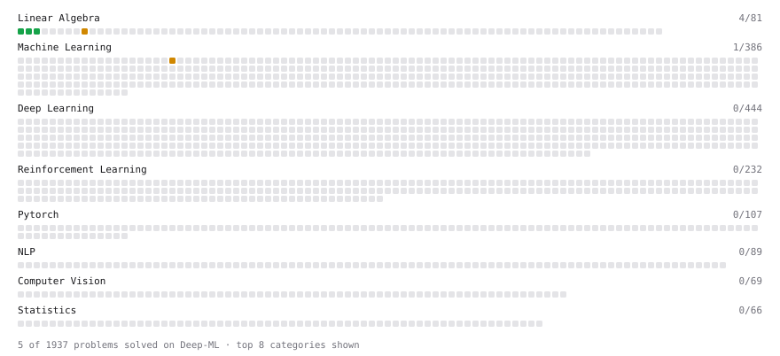

# Deep-ML

My machine learning practice from [Deep-ML](https://www.deep-ml.com). Every solution here was written by hand.

**13** solved · 13 problems · 0 labs · 0 math

[**Browse the interactive portfolio**](https://charliestamp2002.github.io/deep-ml/) to replay this filling in over time.

## Problems

| | Difficulty | Solved | |
| --- | --- | --- | --- |
| [Compute Multi-class Cross-Entropy Loss](https://www.deep-ml.com/problems/134) | easy | 2026-10-18 | [solution](problems/0134-compute-multi-class-cross-entropy-loss) |
| [Feature Scaling Implementation](https://www.deep-ml.com/problems/16) | easy | 2026-09-06 | [solution](problems/0016-feature-scaling-implementation) |
| [KL Divergence Between Two Normal Distributions](https://www.deep-ml.com/problems/56) | easy | 2026-10-18 | [solution](problems/0056-kl-divergence-between-two-normal-distributions) |
| [Linear Regression Using Gradient Descent](https://www.deep-ml.com/problems/15) | easy | 2026-09-05 | [solution](problems/0015-linear-regression-using-gradient-descent) |
| [Matrix-Vector Dot Product](https://www.deep-ml.com/problems/1) | easy | 2026-08-30 | [solution](problems/0001-matrix-vector-dot-product) |
| [Reshape Matrix](https://www.deep-ml.com/problems/3) | easy | 2026-08-30 | [solution](problems/0003-reshape-matrix) |
| [Transpose of a Matrix](https://www.deep-ml.com/problems/2) | easy | 2026-08-30 | [solution](problems/0002-transpose-of-a-matrix) |
| [Implement Gradient Descent Variants with MSE Loss](https://www.deep-ml.com/problems/47) | medium | 2025-12-22 | [solution](problems/0047-implement-gradient-descent-variants-with-mse-loss) |
| [Implement Group Normalization](https://www.deep-ml.com/problems/126) | medium | 2026-10-25 | [solution](problems/0126-implement-group-normalization) |
| [Implement Masked Self-Attention](https://www.deep-ml.com/problems/107) | medium | 2026-10-25 | [solution](problems/0107-implement-masked-self-attention) |
| [Implement Self-Attention Mechanism](https://www.deep-ml.com/problems/53) | medium | 2026-10-25 | [solution](problems/0053-implement-self-attention-mechanism) |
| [Matrix times Matrix ](https://www.deep-ml.com/problems/9) | medium | 2025-12-26 | [solution](problems/0009-matrix-times-matrix) |
| [Single Neuron with Backpropagation](https://www.deep-ml.com/problems/25) | medium | 2026-10-25 | [solution](problems/0025-single-neuron-with-backpropagation) |

---

_This file is regenerated by Deep-ML on every push._
